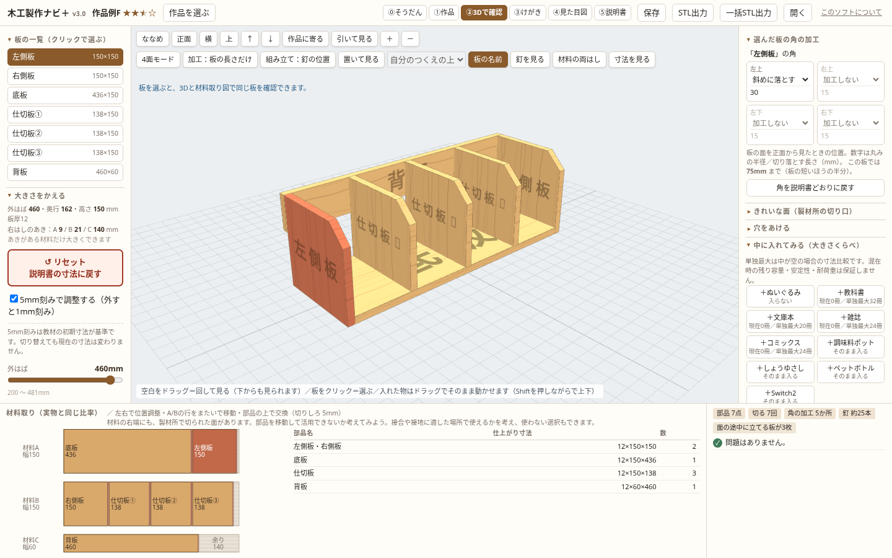

# 木工製作ナビ＋ v3.0

用途と木工経験について6問に答え、12作品から作りたいものを選べます。 
板の大きさや取り付け位置を変え、3Dで組み立て方と収納物の収まりを確かめられます。 
今の設計から、材料取り図・けがき図・釘位置図・製作の手引きを作れます。

## 使い方3ステップ

1. **選ぶ。** ⓪そうだんに答えるか、①作品で直接作品を選びます。切りしろは5 mmと、材料に余裕がある場合の10 mmから選びます。
2. **確かめる。** ②3Dで確認で板を選び、大きさを調整します。下の材料取り図と警告を読み、接合や釘の進路に問題があれば設計に戻ります。
3. **作る準備をする。** ③けがきで測る端を確認し、④見た目図と⑤説明書で形と釘位置を確認します。閉じる前に「保存」で設計をJSONに残します。

[アプリを開く](https://playa2021git.github.io/mokko-navi-plus/) · [全機能・警告の索引](docs/FEATURES.md)

学校の端末では `index.html` と `three.min.js` を同じフォルダーに置き、ブラウザでHTMLを開いても使えます。

## 「合格」の読み方

合格は、記録された条件で、そのテストが比較した値が一致したことを表します。編集した972件の寸法照合は合格し、そのうち381件は製作警告の対象でした。図面間で同じ寸法でも、接合面に穴がかかる設計などは実際の加工に使えません。赤い警告の原因を②で直してから③〜⑤、印刷、編集中の作品のSTL出力へ進みます。材料端の使い方の注意には、確認して先に進めるものがあります。

| 検証項目 | 結果・範囲 |
|---|---|
| Chromium系 | 全12作品の既定寸法・画面切替、83部品のSTL外寸を4縮尺で照合。編集972件、連続操作2,400回を検査 |
| Edge・Safari | 各ブラウザ固有の動作は未検証。過去のEdge名義の実行も実体はChromium |
| 編集の全組み合わせ | 全スライダー・全加工・穴位置の直積、全描画線と穴内壁の実測は未検証 |
| 実材での加工・組立・耐荷重 | 未検証。けがき前に実材と照合してください。作品Lの耐荷重も未検証 |
| GitHub Pages配信後 | 公開先での動作は未検証 |

[作品別の監査報告](docs/CLASSROOM_AUDIT.md) · [テスト実行記録](docs/CLASSROOM_RESULTS.md) · [部品と釘位置の照合表](docs/CLASSROOM_PARTS.tsv)

## ギジュツドットコム掲載情報

| 項目 | 内容 |
|---|---|
| 最終更新日 | 2026年11月22日 |
| 対象学年 | 中学校第1学年を想定（技術・家庭科の技術分野、木材加工） |
| データ区分 | B（氏名は端末内のみ）。説明書の名前は任意。アプリは外部に送信しません。入力すると保存するJSONと印刷物にも氏名が入ります |
| 作者 | 近藤 昌也（金沢市立野田中学校） |
| 連絡先 | TODO |
| 作品例の寸法の使用許可 | 東海北陸大会石川県技術・家庭科大会の会場で、作者が山崎教育システムのご担当者に確認し、同社がインターネットで公開している作品例の寸法を本教材で使用することについて許可をいただきました。 |

[ライセンス（CC BY 4.0）](LICENSE) · [同梱ライブラリのライセンス](THIRD_PARTY_LICENSES.md)
